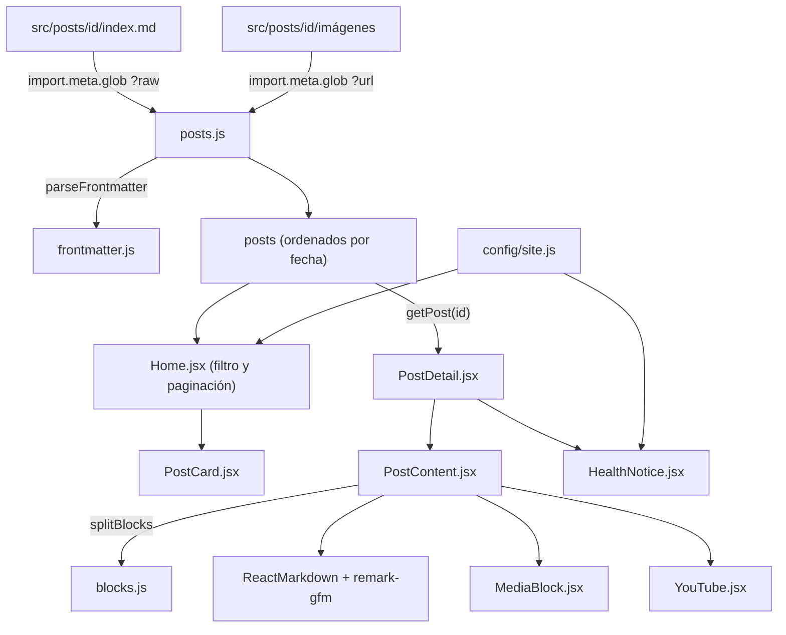

# 01 · Arquitectura

## Visión general

Blog de psicología estático: no hay servidor ni base de datos. Las entradas son archivos Markdown dentro de `src/posts/`, y **Vite las incorpora al sitio en el momento de compilar**. El resultado de `npm run build` es una carpeta `dist/` con HTML, CSS, JavaScript e imágenes que Netlify sirve tal cual.

## Stack

| Pieza | Uso en el proyecto |
| :--- | :--- |
| [React](https://react.dev) 19 | Interfaz: páginas y componentes (`.jsx`). |
| [Vite](https://vite.dev) 8 | Servidor de desarrollo y compilación. Su función `import.meta.glob` lee las entradas y las imágenes. |
| [React Router](https://reactrouter.com) 7 | Rutas del navegador (`BrowserRouter`, `Routes`, `NavLink`, `useSearchParams`…). |
| [react-markdown](https://github.com/remarkjs/react-markdown) 10 | Convierte el Markdown de cada entrada en elementos de React, sin HTML crudo. |
| [remark-gfm](https://github.com/remarkjs/remark-gfm) 4 | Añade a Markdown tablas, tachado, listas de tareas y enlaces automáticos. |
| [Netlify](https://www.netlify.com) | Alojamiento: compila con `npm run build` y publica `dist/`. |

No hay más dependencias de ejecución. El resto (lector de frontmatter, divisor de bloques, paginación) es código propio.

## Árbol de carpetas

```text
blog-psicologia/
├── docs/                      Documentación para quienes mantienen el sitio (no se publica)
├── public/
│   └── _redirects             Regla de Netlify para que las rutas de la SPA no den 404
├── src/
│   ├── main.jsx               Punto de entrada: monta <App> dentro de <BrowserRouter> e importa los CSS
│   ├── App.jsx                Tabla de rutas
│   ├── config/
│   │   └── site.js            Datos del sitio: nombre, correo, redes, entradas por página, línea de crisis
│   ├── lib/
│   │   ├── frontmatter.js     parseFrontmatter(): lector propio del encabezado YAML
│   │   ├── posts.js           Carga todas las entradas e imágenes; expone posts, getPost, formatDate
│   │   ├── blocks.js          splitBlocks(): divide el cuerpo en segmentos (markdown, media, youtube)
│   │   └── useDocumentTitle.js  Hook que pone "<Página> · <nombre del sitio>" en la pestaña
│   ├── components/
│   │   ├── Layout.jsx         Cabecera, navegación, pie y scroll arriba al cambiar de ruta
│   │   ├── ThemeSwitcher.jsx  Selector de los 4 temas de color
│   │   ├── PostCard.jsx       Tarjeta de una entrada en el listado
│   │   ├── Pagination.jsx     Controles de paginación
│   │   ├── PostContent.jsx    Intérprete: dibuja los segmentos de una entrada
│   │   ├── MediaBlock.jsx     Bloque imagen + texto
│   │   ├── YouTube.jsx        Reproductor 16:9 o marcador "Video pendiente"
│   │   ├── MissingImage.jsx   Recuadro "Imagen no encontrada"
│   │   └── HealthNotice.jsx   Aviso de salud al final de cada entrada
│   ├── pages/
│   │   ├── Home.jsx           Listado con buscador, filtro por tema y paginación
│   │   ├── PostDetail.jsx     Entrada completa
│   │   ├── About.jsx          Sobre nosotros
│   │   └── Contact.jsx        Contacto
│   ├── assets/
│   │   ├── themes.css         Variables de color de los 4 temas y estilos base
│   │   ├── global.css         Maquetación general, cabecera, listado, paginación, pie
│   │   ├── post.css           Vista de entrada y bloques del intérprete
│   │   └── pages.css          Páginas Sobre nosotros y Contacto
│   └── posts/
│       └── <id>/              Una carpeta por entrada; <id> es la parte final de la URL
│           ├── index.md       Frontmatter + cuerpo
│           ├── portada.svg    Portada (cualquier formato admitido)
│           └── ilustracion-1.svg …
├── index.html                 HTML base; carga las fuentes Fraunces e Inter
├── package.json
└── vite.config.js
```

## Rutas

Definidas en `src/App.jsx`. Todas se dibujan dentro de `Layout`.

| Ruta | Componente | Descripción |
| :--- | :--- | :--- |
| `/` | `Navigate` → `/home` | Redirección. |
| `/home` | `src/pages/Home.jsx` | Listado. Acepta `?q=`, `?tema=` y `?pagina=`. |
| `/postdetail/:id` | `src/pages/PostDetail.jsx` | Entrada cuya carpeta es `src/posts/<id>/`. |
| `/sobre-nosotros` | `src/pages/About.jsx` | Página "Sobre nosotros". |
| `/contacto` | `src/pages/Contact.jsx` | Página "Contacto". |
| `*` | `Navigate` → `/home` | Cualquier otra ruta vuelve al listado. |

## Flujo de datos

1. **Al compilar** (o al arrancar `npm run dev`), `src/lib/posts.js` ejecuta dos llamadas a `import.meta.glob`:
   - `'../posts/*/index.md'` con `query: '?raw'`: obtiene el **texto crudo** de cada `index.md`.
   - `'../posts/*/*.{jpg,jpeg,png,webp,gif,svg}'` con `query: '?url'`: obtiene la **URL final** que Vite asigna a cada imagen (con hash en producción).

   Ambas son `eager: true`, así que el contenido queda incluido en el JavaScript del sitio; no hay peticiones en tiempo de ejecución.
2. Para cada `index.md`, `posts.js` toma el `id` del nombre de la carpeta, separa el frontmatter con `parseFrontmatter()` y construye un objeto con `id`, `title`, `date`, `author`, `tags`, `summary`, `cover`, `body`, `healthNotice` y la función `resolveImage(ruta)`.
3. La lista `posts` se ordena por `date`, de la más reciente a la más antigua.
4. `Home.jsx` filtra `posts` por tema y búsqueda, pagina el resultado y dibuja un `PostCard` por entrada.
5. `PostDetail.jsx` obtiene la entrada con `getPost(id)` y pasa el objeto a `PostContent`, que llama a `splitBlocks(post.body)` y dibuja cada segmento.



El detalle del intérprete está en [04 · Intérprete y renderizado](./04-interprete-y-renderizado.md).

## Decisiones de diseño

### `.md` en lugar de MDX

MDX permite escribir JSX dentro del Markdown, pero cualquier error de sintaxis rompe la compilación de todo el sitio y obliga a quien escribe a conocer reglas de JavaScript. Con `.md` y solo dos etiquetas propias (`<MediaBlock>` y `<YouTube />`), una entrada mal escrita se ve mal, pero nunca rompe el sitio, y la sintaxis es fácil de aprender para personas no técnicas.

### No permitir HTML crudo

`react-markdown` se usa sin `rehype-raw`, así que cualquier HTML escrito en una entrada se muestra como texto. Esto evita inyectar scripts o estilos por error, mantiene el diseño coherente en los 4 temas y hace que las únicas "etiquetas" posibles sean las que el intérprete conoce.

### Lector de frontmatter propio

El frontmatter usa un subconjunto muy pequeño de YAML (texto y listas). `src/lib/frontmatter.js` lo resuelve en unas 30 líneas sin dependencias, frente a bibliotecas como `js-yaml` o `gray-matter`, que añaden peso al paquete del navegador (y algunas requieren polyfills de Node). Sus límites están documentados en [04 · Intérprete y renderizado](./04-interprete-y-renderizado.md#2-parsefrontmatter).

### Estado de la paginación en la URL

La página, el tema y la búsqueda del listado viven en los parámetros `?pagina=`, `?tema=` y `?q=` (con `useSearchParams`) y no en estado interno de React. Así el botón "atrás" del navegador funciona, un enlace se puede compartir tal cual y recargar la página no pierde la posición.

### Configuración central en `site.js`

Nombre, lema, correo, redes, entradas por página y datos de la línea de crisis están en `src/config/site.js`. Cambiar cualquiera de ellos no requiere tocar componentes, y el aviso de salud de todas las entradas se actualiza desde un solo lugar.
