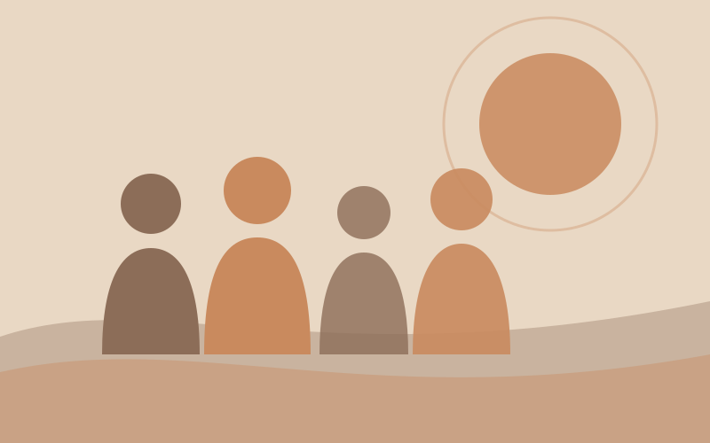

Mariana lleva semanas con el número de una psicóloga guardado en el celular. Lo abre, mira el nombre, piensa en llamar y vuelve a cerrar la pantalla. No es que no quiera ayuda: es que en su cabeza resuena una pregunta que escuchó muchas veces en casa, en la escuela y entre amistades: *"¿Y tú para qué vas al psicólogo, si no estás loca?"*. Quizá te suene familiar. Si alguna vez dudaste en pedir una cita por miedo al "¿qué dirán?", este artículo es para ti.

## ¿De dónde viene la idea de que el psicólogo es "para locos"?

Durante mucho tiempo, la salud mental se trató como un tema del que era mejor no hablar. Las personas con algún malestar emocional eran vistas con desconfianza, y buscar ayuda se interpretaba como una muestra de que "algo andaba muy mal". Esa herencia cultural sigue presente en frases que usamos casi sin pensar, como "ya se volvió loco" o "eso es de gente débil".

El problema es que esas ideas no solo son injustas: también alejan a muchas personas de un apoyo que podría hacerles la vida más ligera. Cuando pedir ayuda se asocia con vergüenza, preferimos aguantar en silencio, aunque el malestar crezca.

<MediaBlock image="./ilustracion-1.svg" alt="Dos siluetas conversando con una burbuja de diálogo entre ellas" align="left">
    ### "Loco" no es un diagnóstico

    La palabra "loco" no aparece en ningún manual clínico. Es una etiqueta coloquial que reduce a una persona a su sufrimiento y la aparta del resto.

    Los problemas de salud mental son **tan legítimos como los de salud física**. Nadie duda en ir al médico por una infección; del mismo modo, atender lo que sentimos es una forma de cuidarnos.
</MediaBlock>

## Razones reales por las que la gente va a terapia

No hace falta estar en crisis para ir con una psicóloga o un psicólogo. Mucha gente acude porque quiere conocerse mejor, crecer o aprender a manejar sus emociones, algo que casi nadie nos enseña de pequeños. Estos son algunos motivos muy cotidianos:

- **Estrés laboral** o sensación de no poder con todo.
- **Duelo** por la pérdida de alguien querido, de un trabajo o de una etapa.
- **Baja autoestima** o una voz interna muy crítica.
- **Conflictos de pareja o familiares** que se repiten.
- **Cambios de vida**: una mudanza, la maternidad o paternidad, el fin de una relación.
- **Ansiedad** o preocupaciones que no te dejan descansar.
- **Autoconocimiento**: entender por qué reaccionas como reaccionas.

Como ves, ninguna de estas razones tiene que ver con "estar loco". Tienen que ver con ser una persona que siente, que atraviesa momentos difíciles y que quiere vivir mejor.

## Mitos que conviene dejar atrás

Además del estigma, hay creencias sobre la terapia que generan expectativas equivocadas o miedo. Vamos a revisar algunas.

### "El psicólogo te dice qué hacer con tu vida"

No. Una psicóloga o un psicólogo no decide por ti. Su trabajo es acompañarte a entender lo que te pasa y a encontrar tus propias respuestas. En terapia, tú eres protagonista activo de tu cambio.

### "Te va a leer la mente"

Tampoco. La terapia no es magia ni adivinación: es un trabajo conjunto que se basa en la conversación, la observación y métodos respaldados por la investigación científica.

### "Te va a recetar pastillas"

Quien estudió psicología no receta medicamentos. Esa es una función de la psiquiatría, que es una especialidad médica. En algunos casos ambas disciplinas colaboran, pero son profesiones distintas.

### "Para eso tengo a mis amistades"

Hablar con personas de confianza ayuda muchísimo, y conviene seguir haciéndolo. Sin embargo, no sustituye a un profesional con formación, que puede escucharte sin juicios, con objetividad y con herramientas específicas.

### "Con una sesión se arregla todo"

La terapia requiere compromiso y tiempo. La duración depende de cada persona y de lo que quiera trabajar; no existe una fórmula igual para todos.

> Pedir ayuda no significa que no puedas con tu vida: significa que decidiste dejar de cargarlo todo sin apoyo.

Si te quedaste con ganas de profundizar, este video complementa lo que hemos platicado:

<YouTube id="PENDIENTE" />

## Pedir ayuda es un acto de valentía

Volvamos con Mariana. Imagina que un día por fin marca el número. Quizá le tiemble la voz al principio; quizá en la primera sesión no sepa bien por dónde empezar. Aun así, ese pequeño paso dice mucho de ella: que se toma en serio su bienestar y que está dispuesta a hacer algo para sentirse mejor.

Pedir ayuda es una señal de **fortaleza**, no de debilidad. Implica reconocer lo que sientes, ponerle nombre y confiar en que las cosas pueden cambiar. Cuidar tu salud emocional es una inversión tan válida como cuidar tu cuerpo, y nadie debería hacerte sentir menos por ello.

Si tú también tienes un número guardado, o estás pensando en buscar uno, date permiso de dar el paso. No tienes que esperar a "tocar fondo" para merecer apoyo.

## Fuentes consultadas

- [La psicoterapia no es para locos — Nalu Psicología](https://www.nalupsicologia.com/la-psicoterapia-no-es-para-locos/)
- [¿Ir al psicólogo es para locos? — Psicólogo Efraín MC](https://psicologoefrainmc.com/ir-al-psicologo-es-para-locos/)
- [La psicología no sirve para nada, es para los locos — Psicólogos Aldaia](https://www.psicologosaldaia.com/la-psicologia-no-sirve-nada-los-locos/)

